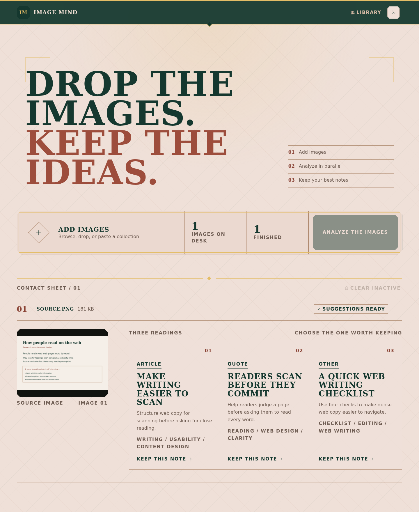
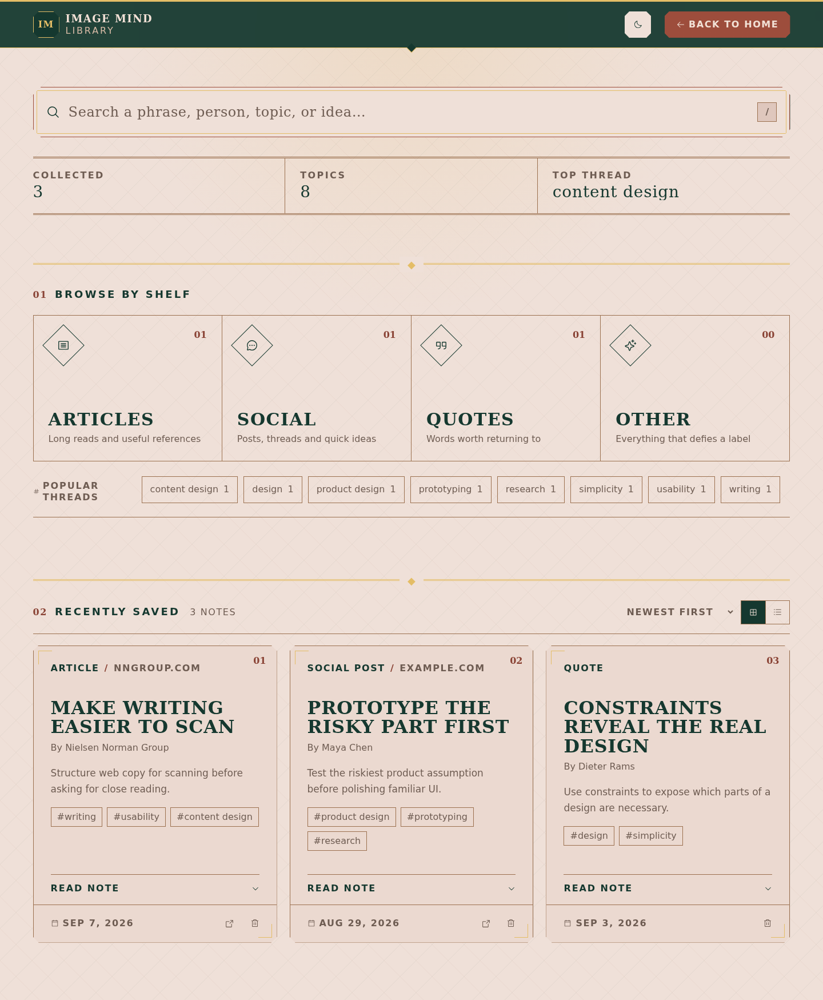

# Image Mind

Turn screenshots into notes you can find again.

Image Mind reads a screenshot, pulls out the useful idea, and gives you three
possible notes. Pick the version that matters to you and save it to your
personal library.



## How it works

1. Add, paste, or drop one image or a whole backlog of PNG, JPEG, and WebP
   files.
2. Run the images together. Image Mind analyzes up to four at a time and writes
   three distinct notes for each one.
3. Choose what to keep. Each note includes a title, summary, source details,
   and topic tags when the image provides them.

The original image stays out of the saved note. Image Mind compresses it in
your browser for analysis, then stores only the note you select.

## Your library

Saved notes live in a library tied to your account. Search the full text,
browse by type or topic, switch between grid and list views, and return to the
source when a note includes a link.



## Built with

Image Mind uses React 19, Cloudflare Workers AI, a SQLite-backed Durable Object
for each user's notes, and Clerk for sign-in. The Worker verifies every API
request before it reads or writes that user's library.

## Run it yourself

You need Node.js, pnpm, a Cloudflare account with Workers AI access, and a
Clerk application.

```bash
pnpm install

cat > .env.local <<'EOF'
VITE_CLERK_PUBLISHABLE_KEY=your_clerk_publishable_key
EOF

cat > .dev.vars <<'EOF'
CLERK_PUBLISHABLE_KEY=your_clerk_publishable_key
CLERK_SECRET_KEY=your_clerk_secret_key
EOF

pnpm dev
```

Local image analysis calls Workers AI remotely and may incur usage charges.
Local notes stay in Wrangler's local Durable Object storage.

Before deploying, add the Clerk keys to the Worker and expose the publishable
key to the Vite build:

```bash
pnpm wrangler login
pnpm wrangler secret put CLERK_PUBLISHABLE_KEY
pnpm wrangler secret put CLERK_SECRET_KEY
VITE_CLERK_PUBLISHABLE_KEY=your_clerk_publishable_key pnpm deploy
```

Run `pnpm check` before deployment. Bindings and Durable Object migrations live
in `wrangler.jsonc`; after changing them, regenerate `env.d.ts` with
`pnpm types`.
